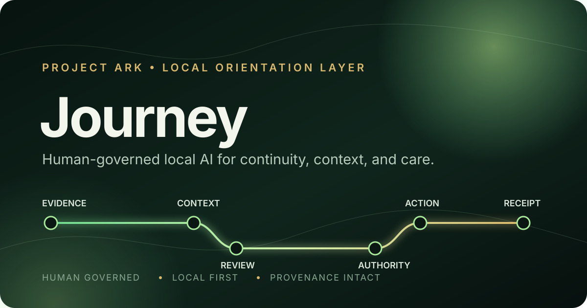

# Journey

**A human-governed local AI system that learns how you work while keeping every meaningful action visible, reviewable, and under your control.**

Journey is being built to help a person and their computer maintain continuity across files, projects, conversations, tools, and time. It remembers where work came from, preserves decisions and relationships, and proposes useful next steps without quietly taking authority for itself.



> Journey is the public product identity. **Mini ARK** is its former name and remains in a few legacy filenames, commands, and the current Windows installation path while migration is completed safely.

## Start here

| If you want to… | Go here |
|---|---|
| Understand Journey in plain language | [What Journey is](#what-journey-is) |
| See what currently works | [Current state](#current-state) |
| Operate the local installation | [Operator handbook](docs/HANDBOOK.md) |
| Understand where the project is going | [Forward architecture](docs/JOURNEY_FORWARD_ARCHITECTURE.md) |
| Review its safety and authority boundaries | [Project boundaries](docs/PROJECT_BOUNDARIES.md) |
| Inspect the technical implementation | [Developer map](#developer-map) |

## What Journey is

Ordinary computer work becomes scattered. A decision may live in a chat, its source image in a downloads folder, its final version in a project directory, and the reason behind it only in someone's memory.

Journey is a local coordination layer for that problem. It is designed to:

- preserve the origin, context, and history of work;
- recognize which project or person something belongs to before classifying its file type;
- reconnect useful information when it becomes relevant again;
- propose organization and recovery actions for human review;
- keep consequential actions attributable and reversible; and
- support several projects without allowing one project's language to become the whole system.

It is not a general autonomous agent and it is not a replacement for human judgment. Its operating principle is **orientation, not domination**.

## What makes it different

### Local first

Private inventories, recovery evidence, and personal-media analysis remain on the local machine and are excluded from this repository.

### Human governed

Journey separates observation, recommendation, approval, and execution. A successful test does not grant the system new authority.

### Context before file type

A PNG may be a family photograph, product artwork, evidence, or temporary output. Journey asks what it belongs to and why it matters before deciding where it goes.

### Provenance is structural

Sources, decisions, receipts, and changes are meant to remain inspectable. Attribution is part of the architecture, not cleanup performed afterward.

## Current state

Journey is an active prototype—not a finished consumer application.

| Status | Capability |
|---|---|
| Working locally | Bounded inventory, reference evidence, privacy rules, classification, journaling, recovery protection, and a Navigator control surface |
| Approval gated | Proposed file operations, asset intake, exports, and undo workflows |
| Deliberately held | Default production moves, semantic providers, broad background observation, and new persistent personal-knowledge storage |
| Active milestone | Project-neutral custody: ownership, provenance, contextual classification, and reviewable placement |

Gate A remains open. Journey has not been granted broad managed-file authority.

For the evidence behind these statements, read the [public checkpoint](docs/JOURNEY_PUBLIC_CHECKPOINT.md).

## Using the current prototype

The present installation still uses the legacy Windows path `C:\mini_ark` and command wrapper `ark.cmd`:

```powershell
cd C:\mini_ark
.\ark.cmd doctor
.\ark.cmd brief
powershell -ExecutionPolicy Bypass -File .\start_mini_ark.ps1
```

These technical names will migrate incrementally so that renaming the product does not break a working local system.

## Developer map

You do **not** need to read every file in this repository. These are the useful entry points:

| Path | Purpose |
|---|---|
| `README.md` | Public front door—the page you are reading |
| `index.html` | Journey's compact Navigator interface |
| `ark.py` | Command-line entry point |
| `core/` | Classification, stewardship, receipts, policy, and recovery logic |
| `config/` | Machine-readable policy and framework settings |
| `asset_pipeline/` | Copy-first intake and reviewable asset processing |
| `docs/` | Operator guidance, architecture, decisions, and boundaries |
| `tests/` | Automated checks for implemented behavior and safety contracts |
| `examples/` | External project profiles that use Journey without defining its core |

## Journey, Project ARK, and external projects

Journey is the local coordinator within the broader Project ARK vision. Project ARK may eventually contain higher-level mapping, memory, and domain systems; Journey is the component responsible for helping the computer remain oriented to the person, their work, and the authority it has actually been given.

Domain projects remain separate. CareBloomOS, for example, was the first mature integration profile. Its small [mapping example](examples/carebloom/README.md) demonstrates how a project can translate Journey's stable functions without turning CareBloom terminology, artwork, or handoffs into Journey's base architecture.

## Naming transition

| Name | Meaning now |
|---|---|
| **Journey** | Product and public repository identity |
| **Mini ARK** / `mini_ark` | Former name retained only where immediate renaming could break local paths or integrations |
| **Project ARK** | The broader future family of systems; not synonymous with Journey |

See the [naming architecture](docs/JOURNEY_NAMING_ARCHITECTURE.md) for migration rules.

## License and authorship

Journey is licensed under the [Mozilla Public License 2.0](LICENSE).

Created and maintained by **Junior Gilmore**. Developed with material collaboration from **OpenAI / ChatGPT**, with AI assistance credited openly rather than absorbed into anonymous authorship.

---

**Journey helps the system remain in relation without pretending that relation grants authority.**
