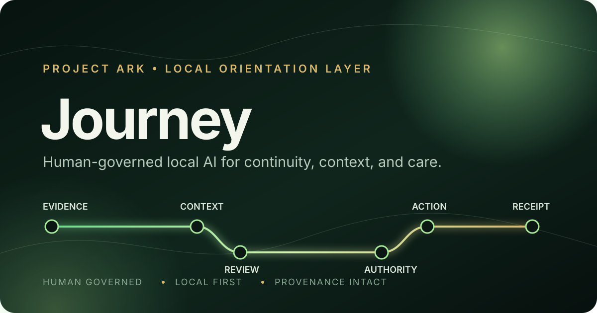

# Journey

**Your computer should make it easier to create, not harder to find what you've created.**

Journey is an experimental, local-first tool designed to help you find, understand, and organize the work on your computer, without taking control away from you.

It is being developed in the open. **Journey is not yet a finished app for everyday use.** You can explore the prototype and the ideas behind it today.



## Why Journey exists

Imagine you've made dozens of pictures for a creative project. Some are in Downloads, others are in Pictures, and one is still being used by your desktop wallpaper.

A simple organizer might move everything that looks related. Journey is designed to do something more useful:

1. **Find** the relevant pictures and understand which project they belong to.
2. **Check** whether another app depends on any of them.
3. **Explain** what can be organized, what should stay put, and what is uncertain.
4. **Ask for permission** when a change needs your judgment.
5. **Keep a record** so you can check what changed and recover when appropriate.

That is the direction we are building toward, **not a claim that this entire workflow is available in the public prototype today**.

> **Orientation, not domination.** Knowing what needs attention does not give software permission to decide for you.

## What can I do with Journey today?

| Available in the public prototype | Not yet available as an everyday feature |
| --- | --- |
| Explore a local browser-based Navigator | Automatic organization of your whole computer |
| Use bounded file inspection and classification components | Unrestricted file moves or deletion |
| Examine safety rules, approvals, and recovery logic | A fully conversational autonomous assistant |
| Run a read-only technical demonstration | Verified compatibility with all assistive technologies |

The public demonstration **does not scan, organize, or modify your files**. Some newer features are being tested separately and are not part of the public default branch.

[See the detailed current state](docs/JOURNEY_PUBLIC_CHECKPOINT.md) · [See the ongoing development](https://github.com/marloweg1-opal/Journey/pulls)

## Explore Journey

**Just curious?** You don't need to know Python or install anything to start learning about the project.

- [See the five-minute project walkthrough](docs/PROJECT_WALKTHROUGH.md) for the problem, approach, and current limitations.
- [Read about accessibility and meaningful participation](docs/ACCESSIBILITY_AND_PARTICIPATION.md), including what has **not** yet been tested.
- [Ask a question or suggest a use case](https://github.com/marloweg1-opal/Journey/issues/new?template=question.yml). You don't need to write code to contribute an idea.

**Want to try the prototype on Windows?** Start with the [operator handbook](docs/HANDBOOK.md). Setup currently requires technical steps; we are not presenting it as a one-click consumer installation.

**Want to inspect the code?** See the [developer map](#for-developers-and-technical-reviewers) below.

## Accessibility is part of the work

We want people to be able to understand, question, refuse, correct, and verify what Journey does.

We **have not comprehensively tested** the prototype with screen readers, switch controls, voice control, text scaling, or other assistive technologies. We do not claim universal accessibility or certification. Our [accessibility disclosure](docs/ACCESSIBILITY_AND_PARTICIPATION.md) distinguishes what has been verified from what remains untested, and describes how we intend to evaluate real tasks.

Feedback about barriers is welcome. Nobody needs to disclose a disability or personal medical information to report a problem.

## What happens to my information?

Journey is designed around local operation, limited permissions, and reviewable actions. Private inventories, personal media, and machine-specific logs are excluded from this public repository.

The prototype is **not** a security-certified product. Do not assume that downloading code automatically grants the whole system access to your computer, or that its proposed protections have all been validated in real-world environments.

[Read the project boundaries](docs/PROJECT_BOUNDARIES.md).

## For developers and technical reviewers

The current public demo prints the stewardship rules included with the repository. It **does not inspect or modify your computer**:

```bash
git clone https://github.com/marloweg1-opal/Journey.git
cd Journey
python -m pip install -r requirements.txt
python ark.py stewardship-contract
```

For structured output: `python ark.py stewardship-contract --json`.

| Resource | What you'll find |
| --- | --- |
| [Project walkthrough](docs/PROJECT_WALKTHROUGH.md) | Purpose, implementation overview, evaluation, and authorship |
| [Operator handbook](docs/HANDBOOK.md) | Current technical setup and operation |
| [Developer architecture](docs/JOURNEY_FORWARD_ARCHITECTURE.md) | System concepts, planned direction, and boundaries |
| [Project boundaries](docs/PROJECT_BOUNDARIES.md) | Permissions, safety, and limitations |
| [Public checkpoint](docs/JOURNEY_PUBLIC_CHECKPOINT.md) | What has actually been verified |
| [Development history](docs/DEVELOPMENT_HISTORY.md) | How HEXSEED, Mini ARK, and Journey evolved |
| [CareBloomOS example](examples/carebloom/README.md) | How a separate creative project helped inform Journey |

Main entry points: `index.html` (Navigator), `ark.py` (CLI), `core/` (stewardship logic), `config/` (policies), `tests/` (checks), and `docs/` (guidance). Some older filenames still use the former name **Mini ARK** to avoid breaking existing installations.

## Who is building this?

Journey was conceived and is directed by **Junior Gilmore**, who defines its goals, user experience, authority boundaries, and acceptance criteria. AI tools have materially assisted with implementation, documentation, testing, and review. That collaboration is openly acknowledged rather than presented as code written entirely by hand.

Journey is licensed under the [Mozilla Public License 2.0](LICENSE). Contributions and thoughtful questions are welcome; please do not submit personal files, credentials, or private machine logs.

**Systems designed to love the people they touch. Always. Orientation, not domination. It's a Journey, not a destination.**
